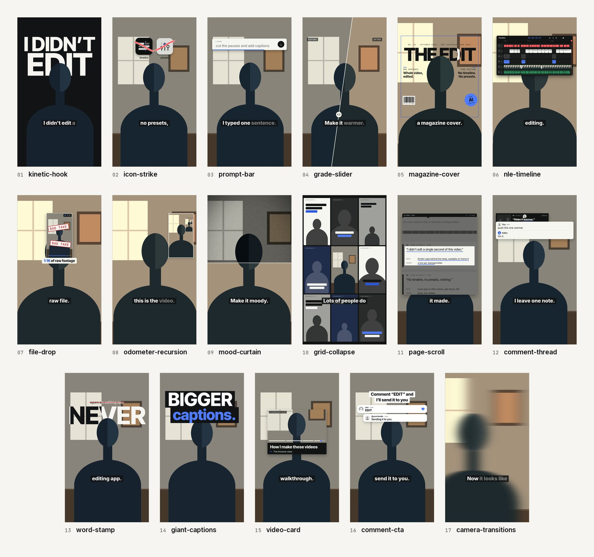

# Effects library (showcase)

Hand-built motion graphics for showcase videos. Every colour and font in them is a token from the creator's style
pack, so each one comes out in the creator's look. A new beat starts from the closest effect: copy its folder to
`<project>/fx/<id>/` (no renaming: `{{ID}}` becomes the id), change the constants at the top of `fx.js` (the words,
the cue words, the labels), and supply what the row says. The contract is `kit/FX_BRIEF.md`; the rules for using
them are `modes/SHOWCASE.md`.

`preview.mp4` in each folder is the effect as it shipped in a Justyn AI video (his footage, his look; in the creator's
video it renders in their style). `preview.jpg` is a frame from the kit's effects lab (`dev/fxlab.py`): a drawn
stand-in figure, the neutral pack, sample words. Placeholders in the effects (icons, headshots, screenshots, clips)
are labelled as placeholders; the creator's real material replaces them. The creator sees all of them, their own
first, on their effects page (`pipeline/effect.py library`).

| folder | layer | what it does | reach for it when the line says | supply |
|---|---|---|---|---|
| `kinetic-hook` (+ `kinetic-hook-front`) | behind + top | the hook: line one in the display face readable on frame 0, the creator's dark ground cuts in as line two stamps letter by letter (the head breaks it), sans lines push through masks on their words over the video's own running timecode, the last tracks in from wide; optional payoff slams in; the front copy carries line one over the speaker for the opening frames, split light/dark by per-frame masks | the first line, a claim about the video itself | the words and the cue word each beat lands on (fx.js constants); `kinetic-hook-front/mkmask.py <project>` rebuilds the masks from clean.mp4; end the front window on the frame the ground cuts in |
| `word-stamp` | behind | one emphatic word in the display face, huge, stamped letter by letter behind the head (the head breaks it), ink where it crosses a light part of the picture; a small line sets word by word above it and a negative stroke strikes it through | one emphatic word: never, huge, always, zero | the word, its line, their cue words, CENTER_X / Y on the head; `mkmask.py <project>` rebuilds the mask from the room behind the speaker |
| `giant-captions` | over | the caption box grows out of the caption band into a giant slab, a display-face line in the accent wipes open under it, optional word tiles and a slab that slams the last word; every slab folds shut before the end | "bigger captions", a payoff line | the words and their cue words; `KARAOKE["hide"]` over the window |
| `icon-strike` | top | icons pop on their names, a hand-drawn stroke strikes each (flinch, grey), they drop with gravity, one word rises where they were | "no X, no Y, nothing" | the words; token placeholder tiles, or real app icons fetched into the project's copy with `icons.py` (never committed); `INK` light or dark for the footage |
| `prompt-bar` | top | the motif: a pill opens into a bar, types the instruction on the words, sends (press, ring, SENT), a line runs, the result rolls in (DONE, check), closes back to the pill | every time they say what they told the AI to do | the sentences; `gen.py` writes every appearance from one BEATS table so the motif is identical each time |
| `comment-thread` | top | a storyboard beat card pops in, a pin with the headshot drops onto a word, the note types into a comment, a reply ("On it.") slides in, an underline lands on the word | "I leave a note", "I just explain what I want", feedback loops | the note, the reply, the beat's line and marked word; the creator's headshot (`HEADSHOT`), optionally two beat stills |
| `comment-cta` | top | the CTA text box holds to the end; a comment field types the keyword on the word and posts, the reply card (headshot, handle) answers word by word, a like, the thread folds into the box; optional Follow chip on "follow" | the CTA | the keyword, the CTA lines, `HANDLE`, `HEADSHOT`; `FOLLOW_ON` for the chip |
| `grade-slider` | cam | a before/after slider tilted 8 degrees splits the frame through the face (BEFORE / AFTER), then sweeps the new look across on the cue word; GRADES takes over at the end | "make it warmer", "it warms up", any look change | a GRADES entry for the look starting at the effect's end (LOOK = its name or a CSS filter) |
| `mood-curtain` | cam | on the cue word the moody look falls top-down like a curtain (the previous look lifts away, a light hem on its edge), then grain and a vignette hold | "make it moody", "the colours go dark" | a GRADES entry for the new look starting between the effect's start and the cue; `grain.png` is made by `make_grain.py` |
| `odometer-recursion` | cam | a mechanical counter rolls the raw take's length down to the finished length, then the frame recurses into itself four levels deep, one level per word, and dives through | "a few minutes later", "this is the video", "exactly what you're seeing now" | the two true lengths (m:ss); the levels are synced copies of clean.mp4 |
| `grid-collapse` | cam | the frame shrinks into the centre tile of a 3x3 grid, eight tiles pop in from the centre out, on the cue word they fall away and the speaker snaps back full frame | "lots of people do this" | 8 real screenshots of others doing it (9:16, headlines readable) replacing the placeholder cards |
| `video-card` | top | a card unfolds, play presses on the word, chapters skip with a moving clip in each (scrubber fills, label rolls), the card folds back into its centre | "I recorded a video walking you through it", a walkthrough or course | clips of the real walkthrough picked by motion with `energy.py` (it cuts them and prints the tags), the title and chapter names |
| `camera-transitions` | over | a different camera move on every picture cut (whip with motion blur, zoom-through, spin, push, drop, reveal), keyed on the footage wrapper so timing and zooms are untouched, overscaled so no corner shows; a cut another full-frame effect starts on is left to that effect | every picture cut | nothing: MOVES (which, in order, cycling; the creator's `modes.showcase.transitions`), SKIP, STRENGTH per move |
| `magazine-cover` | behind | a full cover behind the head: the frame draws, the masthead drops letter by letter in the display face (the head breaks it), dateline, barcode, coverlines on the words, a sticker slaps; all type splits light/ink against the picture | "looks like a magazine cover", "the titles" | true masthead and coverlines (constants); LAYOUT measured on a still (baseline about 60 px under the top of the head); rerun `mask.py` per shot; a CUT_WINDOWS entry |
| `file-drop` | top | a dashed drop zone, the file card falls in on "drop", opens into a player of the raw footage, BAD TAKE stamps slam on the words | "I just drop in the raw footage" | `facts.py <raw file>`: the card's facts (ffprobe) and thumb.jpg; `--clip`: raw.mp4 of filler the edit cut |
| `nle-timeline` | top | an editing timeline of THIS video builds on the words (captions, effects by layer, cutout windows, the cut with thumbnails, transitions, keyframes, waveforms, SFX), a playhead tears across with a running timecode, it folds to a line | "I know nothing about editing", how much work an edit is | nothing by hand: `gen.py` regenerates it from edit.py, timeline.json, words.json, the voice and clean.mp4 (rerun after the mix and any effect change) |
| `page-scroll` | top | a window card slides up with a page, two scroll flicks like a screen recording, one push into a section whose rows light and underline on the words | showing a real document or page, "here is the plan it made" | `capture.py` on the project's storyboard or a URL (prints TILES) plus LIT rows measured on page-full.png; without them, a placeholder plan from the video's own lines |

## Added in 0.3.0
Twenty-three more, first built for a showcase reel and ported here with the same motion, every colour and font
from the pack. Several are alternatives to an effect above (named in the row): pick by the feel of the video, or
let the creator name one (SKILL.md "Effects by name"). Their previews come from the second effects lab
(`dev/fxlab.py --set 2`).

| folder | layer | what it does | reach for it when the line says | supply |
|---|---|---|---|---|
| `contact-sheet-hook` | cam | the hook: two opener lines over the live shot from frame 0 (split light/ink per frame); on the shrink word the shot shrinks into cell 01 of a 6x5 contact sheet on the dark ground while a title sets word by word above it; the sheet then exposes one cell per frame (each still is the frame playing) with an accent cursor walking it, so it fills exactly the real second before the drop; it dives into the last cell and lands full frame on the drop, where the payoff slams in and its second word lands in the accent | a first line about the video itself or about time ("every single frame", "a single second") | OPEN / TITLE / PAYOFF and the KEY words (fx.js constants); `gen.py <project>` pulls cells.jpg and masks.png from clean.mp4 and writes the GEN line; `KARAOKE["hide"]` over the window |
| `receipt-printer` | top | the motif: a slim printer bar drops in above the head, a receipt feeds UP out of its slot line by line on the words (header with number, time stamp and "TO THE AI", the instruction in mono caps, TOTAL 1 SENTENCE), tears off (a torn stub stays) and flies out top right, the printer lifts away; always centred on x 540, same size and move every time | every time they say what they told the AI to do (the prompt-bar alternative) | `gen.py <project>` writes every appearance from one BEATS table (lines plus the word each prints on, head, total, tear words; an edit.py window with the same id wins); SLOT measured on the shot (the bar just above the head) |
| `jiggle-delete` | top | a home-screen row of app tiles on a light panel above the head goes into edit mode (tiles wiggle, delete badges pop, EDIT MODE and a count), each named app's badge is tapped on its name (negative flash) and the tile collapses while the row closes the gap, on the last word the rest hop and drop out with gravity and one word rises in the empty row | "no X, no Y, nothing" (the icon-strike alternative) | APPS (label, glyph, the word it is deleted on); token placeholder tiles, or real icons fetched into the project's copy with `fx/icon-strike/icons.py <project>/fx/<id> "App"` (never committed) |
| `keycaps` | top | editing-shortcut keycaps (J K L, the blade, ripple delete...) rain in on the words with real gravity, pile up on a heightmap over the top of the head, bounce once, then a push broom sweeps left to right and flings each key off as its edge reaches it | "I know nothing about editing", complexity, overwhelm | WAVES (the word each row of KEYS lands on), FLOOR measured on the shot (about the eyebrows), optional BROOM_ON |
| `projected-film` | cam | the shot becomes projected film: on the cue word 35mm rails slide in at the edges (perforations, a variable-area soundtrack drawn from the video's own voice, real edge codes), 15 fps step print, print look with an exposure flicker per film frame, split tone, grain, gate weave, scratch and dust; on the second cue the loop slips and the frame line rolls through once; hard out at B | "cinematic", "like a movie", "old film" | nothing by hand: `gen.py <project>` writes fx.html from the window, the voice and the frame numbers (rerun after the mix); `grain.png` from `make_grain.py` |
| `film-look` | cam | a hard wipe with a light edge on the cue word turns the full frame into film (deep blacks, teal shadows, warm highlights, soft vignette, grain, 1-2 px gate weave), punch-in 1.04 on the next word, hard back to the video's look at B; no bars | "cinematic", "the whole scene changes", only on that line | the two cue words; end the window on the end of its line (on a frame); `grain.png` from `make_grain.py` |
| `eyedropper-grade` | cam | an eyedropper taps five real colours off the shot into a palette card with their hex; on each word the picture steps darker (GRADES) and every chip and hex steps with it, a header notch fills per step, grain on the last step; the card leaves before B | "the colours go dark", any grade change you want to show | one GRADES step per word inside the window, the last ending with the line; `gen.py <project>` samples SAMPLES (label, point) from clean.mp4 on their tap frames and writes CHIPS / STEPS into fx.js |
| `reel-cascade` | behind | the room dims, eight of the creator's own videos fly in out of depth (small, tumbling, fogged, out of focus) and settle into a 4x2 wall behind the head, each landing on a word with a contact shadow, and a jolt through the wall on the spoken ones; on the line's last word they recede into depth, last in first out | "my best videos drop in behind me", a body of work showing up behind you | `mkclips.py <project> [<id>] --from v1.mp4 v2.mp4@3.5 ...` cuts all-intra 360x640 proxies (t1..t8); without `--from` it cuts placeholder stretches of the project's clean.mp4, labelled by PLACEHOLDER |
| `playing-grid` | behind | a 3x2 grid of the creator's own videos, all playing, falls in tile by tile with gravity (squash, one bounce, settles flat), each landing knocking the tiles already up; yanked back up out of frame at the end of the line | "here are my last six videos": the calmer version of reel-cascade | 6 proxies (t1..t6) from `fx/reel-cascade/mkclips.py <project> playing-grid --from ...`; placeholders without `--from` |
| `reel-feed` | cam | a full-frame feed of eight screenshots of other creators flicks past, accelerating, with one frame of vertical motion blur per move and a scroll thumb tracking it, then brakes over three frames onto the speaker (a synced copy) on the cue word | "lots of people are doing this": the fast alternative to grid-collapse | 8 real 9:16 screenshots in this folder, listed in `SHOTS` in fx.js; token-built placeholder cards until then |
| `intertitle` | top | a silent-film title card: a dark iris closes on the face and snaps shut, the dark card irises open with a thin double rule frame (concave corners, diamonds), the line sets word by word in the display face, a diamond rule draws and the key words land under it in the display italic (the pack's own display style when it has no italic), with grain, flicker and gate weave; a hole irises open from the face on the way out | "like a movie", "it reads like a film", any line worth quoting | the words and their cue words, FACE_X / FACE_Y; `mkgrain.py <project>` writes g0..g3 in the pack's light/dark (the lab set ships); KARAOKE `hide` over the window |
| `screenplay-page` | top | the whole frame becomes a screenplay page of the speaker's own lines in the pack's mono face (scene heading, cue, parenthetical, CUT TO:, the next scene dimmed); what was already said is dim, the live line is full ink and an accent highlighter sweeps under each word as it is spoken | "movie script", "like a script", "my lines" | nothing: built from words.json around the window (TAIL / BEFORE / AFTER sentences); NAME = the creator's name, scene headings as labels; KARAOKE `hide` over the window |
| `knockout-captions` | over | the captions grow word by word as the creator's caption boxes, each bigger, the stack pushing up; on the key word a light plate slams down with the giant word cut out of it, so the live footage plays through the letters | "the captions come in huge" (the giant-captions alternative) | the box words, ROWS (the giant word), KEY; the knockout is a live SVG mask in the display face, nothing generated; KARAOKE `hide` over the window |
| `lens-ring` | over | a lens barrel readout unfolds at the top and the ring spins from the first focal length to the last as the camera pulls out of a held zoom, then a dark panel with a keyframe track builds the next words letter by letter (a different move per letter): a text-face row and a display-face row in the accent | "wider shot", "animated captions", "zoom out" | MARKS (focal lengths), OPEN / TURN cue words, ROWS; a CAMERA zoom holding HOLD until the turn word; KARAOKE `hide` from the first panel word to the end |
| `grease-pencil-sheet` | top | a flat contact sheet of the real raw take drops in and bounces, its 12 frames develop in reading order, and a grease pencil in the negative colour circles or X's each frame the edit really cut, one per word: the timecode turns negative, the frame dims, and short labels sit over the first two; it lifts off the top | "the raw footage", "the bad takes are still in it" | the cue words and LABELS (fx.js); `gen.py <project>` pulls the frames from edit.SRC (TIMES, or picked from KEEP: one frame in each of the longest removed ranges), works out junk from KEEP, and writes frames.jpg plus the file's real name, length and size |
| `title-card-dive` | cam | a documentary title card hard-cuts in (dark ground, the video's own running timecode in mono, the title lines rise in display caps on their words, an accent rule), then the live shot shrinks into a generic phone playing this video (true time and length, progress bar), the camera pushes, and it dives back into the screen to land full frame on the last frame | "a few minutes later", "this is the video", "exactly what you're seeing now" | the title lines and their cue words (fx.js constants); start the effect on a picture cut; KARAOKE `hide` over the card; the screen is a synced copy of clean.mp4 |
| `picture-dive` | cam | the frame shrinks into a framed picture of itself on the wall behind the speaker, four levels deep, one per word (each inner speaker in front of their own picture); on the cue word the picture grows to fill the frame while the speaker sweeps past the camera faster (parallax, never a double exposure) | "the one you're watching right now", "exactly what you're seeing", recursion | PIC (left, top, width of the picture, measured on a still); the cue words; carries its own cutout, so no CUT_WINDOWS entry |
| `live-markup` | cam | on the turn word the live shot gets a short camera punch as BW takes it to black and white, and it keeps playing (never a freeze); a grease pencil in the negative colour loops the head twice, writes "me" and curves an arrow into the loop, all riding a head track | "but my way is different", any line where the speaker singles themselves out | the cue words and WORD (fx.js); `track.py <project> [--head X,Y]` finds the head with subject.webm, template-matches it through clean.mp4 and rewrites HEAD / TRACK; an edit.BW entry from the punch word |
| `storyboard-deck` (+ `storyboard-deck-flip`, `storyboard-deck-note`) | top | the video's own storyboard as cards: the deck slides in and the beats deal face up into a grid, the last card slams down; (flip) the grid gathers under the hero, which lands big beside the head and flips to show its plan ruled like an index card, underlines landing on the words; (note) it turns back to its frame, a comment types the note, the problem gets marked, the frame wipes to the fix and a check lands | "it plans every beat", "it shows me its thinking", "I just leave it a note" | `gen.py <project>` after pipeline/storyboard.py (cards, hero, before/after frames; falls back to frames from clean.mp4); the note, NAME, HEADSHOT (a token circle with initials until then) in the note's fx.js; keep the three windows back to back |
| `gravity-drop` | behind | one emphatic word drops in from above the frame one letter at a time (4-frame fall, one landing every 2 frames) and lands with weight (a squash, one hop, the word nudged down per impact) on a baseline the head breaks; light/ink split per frame | one emphatic word, a second time (word-stamp's variant) | the word, its cue word, CENTER_X / Y (fx.js); `gen.py <project>` writes masks.png from clean.mp4 with the speaker left out via subject.webm; a CUT_WINDOWS entry |
| `video-backdrop` (+ `video-backdrop-label`) | behind + top | the walkthrough replaces the room behind the speaker, full bleed and dimmed; each chapter pushes in from the right on its word while the old one parallaxes left and darkens; the room pushes back in at the end. The label is a numbered chapter lower third with a rail; one label at a time, never overlapping | "I recorded a video walking you through it": the full-bleed alternative to video-card | `mkclips.py <project> [<id>] <recording> [--col X] [--rate R]` picks moving moments, cuts 9:16 screen columns w1..wN and prints the `<video>` tags to paste over the placeholder blocks; the label's chapter names go in its CHAPTERS constant (keep CUES / AT / OUT_ON in step with the backdrop) |
| `comment-drop` | top | the CTA hovering above the head: a comment composer slides in, the keyword's letters pop in big and fall with gravity into it one by one (the field types each), it posts and lifts, the reply (headshot, handle) drops in under it word by word, a like, both float away; the big letters split light/dark against the picture via per-frame masks | "comment X below" (the comment-cta alternative) | KEYWORD, the cue words, REPLY, HANDLE, HEADSHOT (until then a token circle with INITIALS), GROUP_Y measured on the shot (GROUP_Y + 292 sits on the head top); `gen.py <project>` rebuilds masks.png from clean.mp4 |
| `shape-transitions` | cam | a different shape-mask transition per picture cut (iris, blinds, barn doors, match push, clock wipe) in the frames before the cut, the incoming side a pre-roll handle in sync with the J-cut audio; a cut a full-frame effect covers is left alone | every picture cut (the camera-transitions alternative) | nothing: `handles.py <project>` cuts the handles from edit.SRC like cut.py and writes fx.html (rerun when KEEP, SHOTS or FX change); SHAPES, ONLY, SKIP, FRAMES_PER, FACE in fx.js |

## Added in 1.2.0
Twenty-seven more, built from the footage itself. Each pre-renders its clip from the take (the cutout, face and hand
tracking, depth, the room behind the speaker) with its own `gen.py <project> [<id>]`, so the graphics sit in the
room, in front of the speaker or behind them, in sync with the voice. Every colour and font is still the pack's; real
objects (a phone's call banner, newsprint, a banknote) keep their real colours. The rows that ask for a tripod and the
empty room need the room behind the speaker: 5 seconds of it at the end of the take (the creator walks out and lets it
record, `EMPTY` in edit.py), a clip or a photo from the same spot, or, when the creator asks for it, a background
generated from the take (`plate_finish.py --bg-frame`, then `--fill`; `modes/SHOWCASE.md`). Without any of them they
use a guessed room, which shows when the speaker moves. Tracking and depth install the first time one of these needs
them. Their previews, the video and the still, are the effect in the Justyn AI video it was first built for.

| folder | layer | what it does | reach for it when the line says | supply |
|---|---|---|---|---|
| `press-front` | over | a broadsheet front page from the first frame with the speaker live in the photo as a one-ink 45 degree round-dot halftone (a static screen, only their dots breathe); the deck prints word by word as it is spoken, the body columns, index and pull quotes are the video's own words; masthead and heads in the pack's display face, newsprint and ink stay real; a press slam on the first frames | the hook, a claim that deserves a headline, "so I made this" | HEADLINE, DECK cue words, AD (a labelled placeholder until set) and the other page constants in `gen.py` (defaults from words.json; byline and caption from the pack's name, else the handle, else none); `gen.py <project>` writes the clip and `work/fx/<id>/last.png` (what `paper-tear` tears); tracks and the plate room optional; KARAOKE `hide` over the window |
| `paper-tear` | over | the picture before a cut rips in two like paper: seeded torn edge, raw fibre bands, the sheet bends with real shading, a contact shadow, the halves turn and leave off the sides with the next shot live underneath; the page is the shot itself, a press-front page, or any full-frame clip or still | a printed hook, "tear it up", leaving a front page, a card or the shot itself | a picture cut or reframe 4 frames into the window (or a PAGE over the live shot); PAGE in `gen.py` ('' = the shot, a press-front id, a clip or still); tracks optional; `gen.py <project>` renders it (about a minute) and synthesizes `audio/paper-rip.wav` (`mk_rip.py`) |
| `blade-slice` | cam | one frame of hairline on the word, the live shot cut along a line through the speaker's mouth, the two halves slide apart over a dark gap still talking, then slam home with a back ease and a punch just after the voice stops | one violent word: hated, cut, killed | WORD in `gen.py`; tracks (`track.py`), words.json, voice.wav; `gen.py <project>` finds the mouth and the slam; no matte, no plate |
| `day-dial` | cam | the frame becomes a clock face with the speaker's head as the hub: an accent hand ticks one hour per spoken word, each swept hour turns into a printed sheet in the pack's light colour (ink rings, display-face numerals, one word per hour) with the speaker's live shadow on it while the real room left darkens; the last wedge carries a label and closes on its word with a shove, then the hand spins back to live | a day or time being eaten: "every hour went to X", "there was no time left for Y" | `WORD`, `LABEL` and the cue words (gen.py constants); matte and track.json; a tripod or a stand with room above the shoulders; about 10 to 13 words in the window (a shorter line runs on a clock); `gen.py <project>` renders the clip and its unwind sound and prints the SFX |
| `predict-keys` | top | a phone keyboard in the pack's colours rises and types the line as it is said, the predictive bar updating every keystroke; the bar offers three words, a soft tap picks the one said, it jumps into the sentence in the accent, send, it drops | a line that lands on one chosen word: "what I struggled with was ideas" | LINE, PICK and SUGGEST in `gen.py`; words.json onsets; tracks (the keyboard scales to clear the chin); KARAOKE hide over the window |
| `impact-frame` | over | anime impact: on the word the live shot turns to pure ink (line work on the head, a brushed silhouette, a solid black body), two frames negative, two positive, two negative with fresh hand-ruled focus lines off the face, then the word stamps flat out of the black in the display face; hard cut back to live, 14 frames | one emphatic word that has to hit: never, always, zero | nothing by hand: `gen.py <project>` reads the face, the matte and the word off the take and pushes in to a close shot; start the window on the word's onset (it prints the voice onset); KARAOKE `hide` to the next line |
| `orbit-ring` (+ `orbit-ring-front`) | behind + top | a ring of type orbits the head in real perspective, the far half behind the speaker and the near half in front, locked to the face track; each word reaches the front and lights in the accent as it is spoken, then the ring whips round and reels into the back of the head without ever crossing the face; true motion blur per letter | a list they name: "maybe it's X, or Y, or just Z" | TEXT (the items, in caps) in `gen.py`; `gen.py <project>` writes both halves; two FX entries with the same window inside one shot (no cut or reframe in it), plus a CUT_WINDOWS entry; hide captions if they repeat the ring |
| `dolly-zoom` | cam | the Vertigo shot: the speaker holds size and place, lips in sync, while the room rushes forward behind them, the real move computed from the room's depth (the wall as a plane, furniture by its own distance, the desk falls back a touch); lands on the word, holds, goes home | a realisation: "the second I saw it", "it hit me" | a tripod and the empty room filmed at the end (`EMPTY`, then the plate tools; without it the patch behind the speaker is a smooth fill that grows into view and shows), the depth model, matte, track; something between the speaker and the wall; `MOVE_ON`; a line where they hold still; `gen.py <project>` |
| `banknote` | over | the speaker becomes the live engraved portrait on a generic pure-math note (guilloche, rosette, microtext of their own words, a serial in a second ink, real note paper and inks); the number prints glyph by glyph in the plate and the corners on its words and the whole note hits once more on the last word; all type in the pack's faces | a money line: the real revenue, a launch number, what something earned | NUMBER and TITLE (the creator's real ones), one cue word per glyph (LANDS_ON) or a quick run; the face track and depth; `gen.py <project>` pre-renders note.mp4; FLIP for a mirrored selfie; a KARAOKE hide |
| `voice-note` | top | the line becomes a voice message: a chat bubble with the headshot pops (above the head, or under the chin when the head fills the top), the line's own waveform fills behind a playhead in real time (each bar plucks), a running time, the transcript pill grows word by word, a soft tap sends it, it flies off up-right, Delivered; dark or light skin | "I had to share it", "I told them", "I sent it" | nothing by hand: `gen.py <project> [<id>] [--theme light]` builds it from the window's words, assets/voice.wav, the matte and track.json (where it sits, and which skin stands out there) and the creator's headshot (a placeholder glyph until there is one); `KARAOKE["hide"]` over the line |
| `letter-dive` | over | a plate in the pack's ground slams over the frame with one word cut out of it in the display face, the shot playing through the letters; the word builds letter by letter, then the camera dives into a letter's stroke and lands in the next shot on the cut | one loaded word right before a cut | WORD and SLAM_ON in `gen.py`; a picture cut or reframe ending the window (pre-roll); tracks optional; `gen.py <project>` picks the stroke and the baseline and prints a CAMERA punch; no matte, no plate |
| `live-cursor` (+ `live-cursor-room`) | top + cam | a multiplayer cursor with a name flag walks in and edits the video while the speaker talks: a marquee, a box tracking their real silhouette with a live pixel readout, it drags them across the room (desk and mic stay), drops a card of the creator's clip in the gap, then everything clears back to the live shot | "I had Claude edit it", "it did X for me", any line about the AI doing the work | BEATS (enter, select, drag, drop, click, exit: cue words or offsets; under 2 s a short enter, select, drag, exit), NAME (default: the creator's first name, else their handle, else no flag), the card's clip (`src`; a labelled placeholder without it); the empty-room plate for the drag (on a fallback plate or handheld the drag is left out and the card lands beside the face); `gen.py <project>` writes both folders and prints both FX entries and the SOUND lines |
| `head-stack` | top | labelled tiles fall on the words and pile on the speaker's real moving silhouette with rigid-body physics (the pile rides the head, slips, a tile slides off the tower), a contact shadow on the speaker only, true motion blur; on the release word the tower topples off past the ear | a load piling up: "every hour went to X", overwhelm, then giving out | TILES (the labels) in `sim.py`; `gen.py <project>` searches for a pile that holds on this take (a few minutes) and writes it; fewer tiles on a selfie |
| `rack-focus` | cam | nothing added: on the cue words the room racks out of focus and dims behind the speaker (depth-sized lens blur in linear light, focus breathing) while they stay the live pixels, razor sharp, and a desk in front melts over them; hard cut out at the end | "the part you love", "focus on", any line that should narrow down to them | RACK_ON cue words (default: the first word, landing near 62% in); `gen.py <project>` reads depth, the plate room (else the window's own frames) and the desk layer; a locked-off shot; no sound on purpose |
| `code-body` | cam | a hairline scans the speaker into a mono grid of the real code that edited the video, live and in sync, on the pack's dark ground with the clothes in their own colour; the cells step down on the words until the face resolves, then the line runs back up | "Claude", "AI", "automation", what's under the hood | nothing by hand: `gen.py <project>`, about 40 s; run it last so the code on screen is final |
| `post-wall` | behind | a square per day on the wall behind the speaker, one month per row, newest on top: the empty calendar draws up the wall, squares land in date order faster and faster behind a leading edge, a mono counter rolls to the total, the last square pops in the accent on the word, the speaker's shadow falls on the landed squares; type and ramp follow the wall's own tone, labels keep clear of the speaker; in and out with a picture cut, else a wipe up the wall | "I posted every day", "I needed to post more", any streak or body-of-work claim | the creator's post dates (DATES or work/post_dates.json; a labelled PLACEHOLDER set until then), the TOTAL and DAYS they say, cue words; the CUT_WINDOWS gen.py prints; tripod and the room plate only for HOLE (something comes off the wall) and FRONT (what stands in front stays in front: depth or unlike the wall, checked in work/<id>/front.jpg) |
| `clone-row` | cam | six more of the speaker, all talking, slide out from behind them in pairs into a perspective line on three words and snap back into them on the next, each a frame behind the last, fading out below the collar | "people like me", "anyone like you", multiplication | nothing by hand: `gen.py <project>` reads the head and its width off the matte and the track; end the window a little after the snap-back word |
| `layer-explode` | cam | a motion-control swing pulls the live frame apart into the edit's real sheets (the room, the cue words in the display face, the speaker live, the real captions word by word, the video's waveform), holds as an exploded view and folds back flat with no seam; filmed through the renderer with a 180 degree shutter | "every single piece", "all the parts", how an edit is built | a locked-off shot and the plate room; WORDS cue words (default: the first three spoken); `layers.py`, `gen.py`, `calib.py` once, `prerender.py --passes 24` (about 3 min); KARAOKE `hide` over the window; no camera move or picture cut inside it |
| `sketch-words` | cam | the words are drawn on their spoken words while the speaker stays live: the key word as a pencil comp from the display face's real outlines (ruled guides, three passes, accent hatching, an underline), the words around it handwritten word by word, boiling on threes; on a paper sheet in the pack's light colour behind the speaker (moved down for headroom) or in light pencil on the footage, across the chest | "for me, that's X", an idea, a draft, writing: one word to land | `WORDS` rows (text, kind) and `GROUND` (gen.py constants); the matte (track optional); a `KARAOKE["hide"]` over the window; any footage, phone too; `gen.py <project>` writes the clip and its pencil sound, `--specimen` draws the pack's face in pencil |
| `blow-away` | cam | a jolt on the word, dust strips off the windward edges, then a front of wind turns the speaker into sand in their real colours (what it hasn't reached stays live); the desk and mic stay, and the empty room holds with a few specks drifting | "blew me away", "gone", "vanished", a last line | a tripod and the empty room filmed at the end (`EMPTY`; without it the hold is a smooth guess that shows, so end the window before they're gone: gen.py prints when), matte, track; `HIT_ON` / `GONE_ON`; `gen.py <project>` writes the clip and its own sand sound |
| `incoming-call` | top | a phone's call banner (a phone's own dark, red and green) drops in on a word and buzzes in two-burst pairs while the speaker keeps talking, a soft tap declines it on the word, it squashes and flies off, a small "Call declined" pill; played deadpan | a line that dismisses someone or something: "that isn't for you", "I stopped answering", "who needs X" | CALLER (a role, "Your Video Editor" by default) and the cue words; `gen.py <project>` writes audio/phone-buzz.wav with mk_buzz.py; track.json keeps it above the eyes, or under the chin when the face fills the top |
| `search-suggest` | behind | a generic search pill drops in above the head, the query types in bursts on the words, real autocomplete rows swap per prefix with the untyped part bold, floating behind the head with its shadow on them; the top row is tapped on the last word and it lifts away; a picture cut inside the window is handled (the rows sit the cut frame out) | "I needed to...", "how do I...", anything people actually search | the network once (a dated suggest.json, wording untouched; `--refresh`; read the printed rows, SKIP any); QUERY when it isn't word for word what's said; the CUT_WINDOWS gen.py prints; the matte (it scales until the top row clears the head) |
| `double-exposure` | cam | a hard cut to a flat field in the pack's dark (or light) ground: the speaker's live silhouette in high-contrast mono (the filter picked for their clothes without blowing out the face; on a near-black ground their blacks print a step lighter so dark clothes still read) with real footage screened into their chest and shoulders (never the face, lips in sync), the figure fading off at the chest, a mic painted out, the inner footage hard-cutting on the words; the line runs over it as title credits (a role line over a spaced-caps name in the display face) | a list about the creator or the work ("maybe it's X, or Y, or just Z"), anything that should feel like a film's title sequence | the creator's clips (a few moving seconds each, exposed automatically) in `fx/<id>/inner/` or INNER in `gen.py` (labelled PLACEHOLDER pages until then); INNER cue words and CREDITS (fx.js); `gen.py <project>` pre-renders exposure.mp4 from the cutout and the face track (`--survey` ranks clips by motion); best on a medium shot, starting on a picture cut; a mic layer when there is a mic; a KARAOKE hide |
| `shockwave` | cam | one refractive ring radiates from behind the head on the word: pure displacement of the real picture, the room takes it while the head stays locked, plus a 2-frame shove; nothing added | one word that should land like a hit: never, always, zero | any footage, phone too: matte and track (a filmed empty room sharpens the edges); a straight edge in the room to bend (a frame, a window, a shelf); `HIT_ON`; `gen.py <project>` |
| `room-doors` | cam | the wall cracks open behind the speaker's head on the word and two heavy panels roll apart on inertia onto a real page lit like a thing in the room (light falls in, panel and lintel shadows, the speaker's own shadow, lens blur); the speaker and the furniture stay put; off a picture cut they roll shut again before the window ends | "the doors open", "I'll send you the link", any launch or reveal | a locked-off shot; the page as `page.png` (any tall image) or `--capture` with PAGE_URL (a labelled placeholder page without one); SEAM_ON cue word; the empty-room plate, desk and mic layers (a fallback plate works, with soft streaks beside the speaker); end the window on a picture cut or give it about 1.3 s from the cue word; `gen.py <project>` writes the clip and its own rumble (`audio/<id>-rumble.wav`) |
| `finger-draw` | cam | a dry grease-pencil line in the accent follows the speaker's real fingertip (read off their skin per frame): `path` draws whatever the finger draws between two holds; `numeral` rises with a raised finger, melts into it while it's held and leaves a hand-drawn 1 hanging behind the hand on the whip (rise, hold and whip read off the finger's path); optional mono label lines on their words; its own synthesized marker sound | "one", "first", counting on a finger; a chart or path the speaker draws on purpose | a take filmed for it (README: about 5 s, camera still, one finger drawing slowly; for the numeral one finger up on its word, held half a second, flicked away); MODE, PEN_DOWN (numeral: the word the finger is up on) / PEN_UP and LABEL in `gen.py`; the hand and face track; depth for `numeral`; it stops with a message when no hand is tracked; OVERRIDE for frames the tracker misses |
| `follow-chip` | top | the sign-off chip over the top of the captions band (comment-cta's chip): headshot, handle, Follow button; rises just before the sign-off, presses to Following on "follow" (a check draws), a line slides in under the handle; holds to the end | "follow me", "make sure to follow", any sign-off | `gen.py <project>` puts the pack's handle (else site, else name) and the headshot at assets/headshot.jpg on it (a placeholder glyph until then); SUB and the cue words in fx.js; captions stay on |

## Rules that came out of building these
- `hyperframes check` gates the render: every `<video>` needs an id (else it renders frozen), no tweening layout
  props (left, top, letterSpacing: use x / y / scale), no CSS `transform` on an element GSAP tweens, overlap and
  occlusion allowances on the text elements themselves.
- Media timing is written with `{{START+x}}`, `{{SYNC+x}}`, `{{DUR}}` / `{{DUR-x}}` (the build fills them in), so
  a copied effect times itself. Footage copies are frame-identical to the main picture (proven by pixel diff in the
  lab). Hide a copy with opacity, never `visibility`.
- Type over footage splits light/dark against the picture (masks), never an outline. Text fitted after the pack's
  fonts load keeps its fx.html size as a maximum and only shrinks.
- `clip-path` tweens use `fromTo`; a `.to` jumps.
- A snapshot taken exactly on a cut can show the previous frame; check transitions at mid-frame (cut + k/30 + 0.012).
- Generators live next to the effect (`gen.py`, `mkmask.py`, `energy.py`, `icons.py`, `make_grain.py`): rerun them
  when the cut moves. They refuse to write into the library folder itself.
